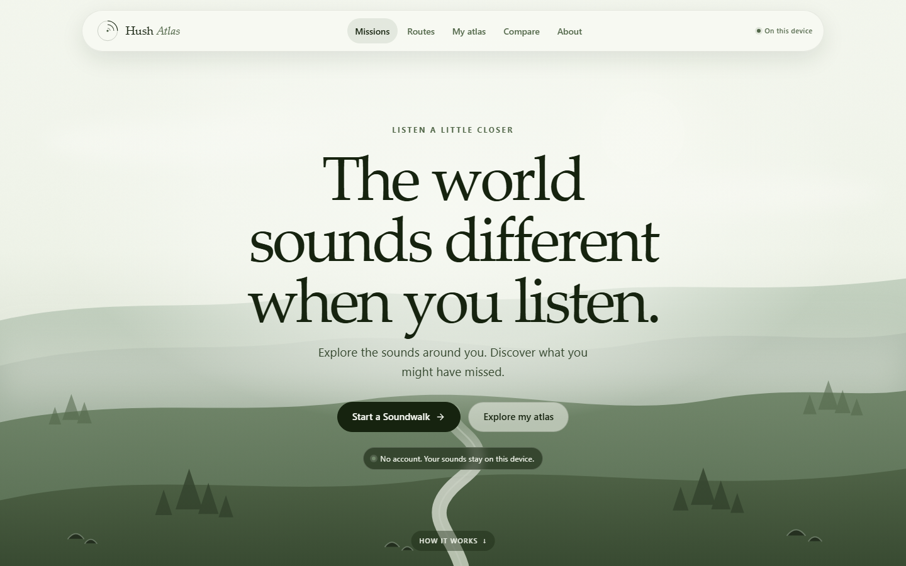

# Hush Atlas: an AI soundscape explorer that keeps the evidence

*Draft for the Hacktoberfest 2026 Week 4 dev post. Replace the repository placeholder before publishing. Built for **#devchallenge #hf26challenge**.*

---

Most "AI for nature" demos end with a confident sentence: the birds are disappearing, the forest is changing, the place is becoming quieter. A model produced a class label. The interface produced a story.

I wanted to build the opposite: a field instrument that keeps the measurement, shows its limits, and makes the story wait.

**Hush Atlas** is an open-source AI soundscape explorer. You choose a real listening mission, walk a route, record what you hear, and turn the evidence into a map you can revisit. It is a complete React + FastAPI application with SQLite persistence, not a mockup. YAMNet runs on the same device that stores the archive; no audio leaves the machine.

The project began as an earlier archive prototype. The useful parts were the real local inference, the evidence tables, and the comparison engine. The part that did not work was the framing: a dashboard asked people to upload files, then told them what the model thought. Hush Atlas starts with an activity instead. The model is still there, but it is downstream of listening.



## Why missions instead of a dashboard?

A detector answers a question about a file. A soundwalk asks a person to notice a place.

The home page offers three missions, and only real counts from the local database:

- **Five Sounds** — walk a short loop and listen closely at several ordinary places. The name describes the invitation, not a required number of model detections.
- **One Place, Two Moments** — map a familiar place today, then return another day and walk the same route. The comparison is strongest when the route, time of day, clip length, and equipment stay similar.
- **Find the Quiet** — visit several safe places and compare the detected event patterns at each. No stop is declared objectively quiet or loud; the mission compares evidence, not calibrated loudness.

Each mission has a minimum, suggested, and maximum number of stops. Completion is derived from saved recordings, not from a score. The mission sets the shape of the walk; the listener chooses the place.

## What a walk actually stores

A Soundwalk is a persistent session, not a one-off upload form.

- **Pause and resume.** Close the browser mid-route and come back later. The session, stops, observations, recordings, and analysis state are kept in SQLite.
- **Listen before recording.** A stop starts in `ready_to_listen`. The recorder stays locked until the listener explicitly marks that they have listened and unlocks it.
- **Observations are separate from model labels.** The stop stores the listener's written note. The recording stores YAMNet's broad AudioSet classes. Neither field overwrites the other.
- **Explicit capture.** The interface shows whether it is recording, waiting for permission, encoding, or ready to save. Audio is written to the local archive before analysis starts.
- **Failed analysis preserves the clip.** If inference fails, the audio remains playable and downloadable, the failure is visible, and analysis can be retried.
- **Manual location always works.** Places and stops can be named and ordered without GPS. Coordinates are requested only after an explicit button press and are displayed as saved metadata.
- **No remote map tiles.** The route map is drawn locally as an ordered diagram. When coordinates exist, they place the stops; otherwise the diagram uses stop order. The map supports selecting detected classes and inspecting each stop.

## From a walk to evidence

The evidence pipeline is the part I refused to fake.

1. **Validate and decode.** `soundfile` reads the file and a streaming amplitude envelope. Default limits are 80 MB, 180 seconds, 8 channels, and 96 kHz. Damaged, empty, too-short, and over-limit files are rejected with actionable messages.
2. **Prepare the model input.** Channels are averaged and resampled to 16 kHz mono float32. Audio is not loudness-normalized.
3. **Infer.** The vendored YAMNet code loads official weights and scores each 0.96-second window with a 0.48-second hop. It returns 521 AudioSet classes.
4. **Persist.** Windows at or above the threshold are counted per class. Contiguous detections become event spans. The full score matrix is stored as compressed NumPy data under `data/analysis/`; statistics and events go into SQLite.
5. **Compare.** A recording's class detection rate is the share of its valid windows above the threshold. A group rate is the unweighted mean of its recordings' rates. Differences are percentage points, computed in Python.
6. **Investigate.** Each comparison result opens back into the original recordings, event rails, stop context, window counts, peak scores, thresholds, and warnings. Fingerprints and Markdown reports are generated from the same stored data.

The calculation code is testable without TensorFlow. Separate integration tests run the real model on a generated 440 Hz tone and check that `Sine wave` appears in the top ten classes. The sample archive is not a set of fixture labels; the synthesized audio really goes through YAMNet.

## Repeat visits and change investigation

A route is reusable. Repeating a completed walk creates a new active session with the same stop order and a link to the earlier visit. The comparison preview pairs stops by position, shows which pairs have usable evidence, and refuses to invent pairs that do not exist.

The comparison engine reports detection rates, percentage-point differences, fading flags, and warnings about group size, mixed sources, backwards dates, and very different clip lengths. A fading trace is a descriptive comparison, not proof that a sound has disappeared. The evidence page repeats that limit beside the recordings.

Old obituary links from the earlier prototype redirect to the new evidence view. The underlying data did not need to be discarded to change the framing.

## A safe migration, not a rebuild

The existing SQLite archive is upgraded in place. Schema version 2 adds routes, route stops, walk sessions, and walk stops, plus links from recordings and comparisons to walk context. The migration is additive:

- Existing places, recordings, analysis runs, and comparisons are preserved.
- New columns get safe defaults.
- New tables are created if absent.
- Running the migration twice is idempotent.
- A database from a newer schema version is refused rather than modified.

The visible product is Hush Atlas. The database filename and `SILENCE_*` environment prefix keep their old names so existing installations continue to work.

## Making the writing tool earn its place

**On-device AI** is the name of the feature. It runs Gemma 2 2B (4-bit, about 1.4 GB) inside the browser with WebLLM and WebGPU. Nothing is downloaded until the user chooses **Download model**. The page reports the real model name, size, and GPU adapter; shows real download progress from the runtime; can cancel; and resumes against the browser cache. The model is marked **AI ready** only after a real load and test response succeed. In browsers without WebGPU or enough storage, the panel says so plainly and the rest of the atlas keeps working. The model runs in a Web Worker so generation does not block recording or navigation.

Reflections are grounded in the evidence the archive already has: place, class, model, group sizes, date ranges, window counts, rates, difference, classification, thresholds, and a limitation statement. Generated text is checked. Responses are rejected if they introduce unsupported causes, permanence claims, proof claims, URLs, percentages, or years. Numbers and comparisons are still computed deterministically; the model only writes prose.

A server-side reflection route backed by a loopback Ollama model remains as a development fallback. It is documented separately and is not presented as the on-device feature. The README states what was actually exercised in the test environment rather than treating a mocked reply as model proof.

## Designing an instrument instead of a dashboard

The visual direction is a light sage travel landing page: a full-width local landscape, a floating rounded navigation bar, centered editorial type, and a restrained green palette. The hero keeps the invitation explicit: **“The world sounds different when you listen.”** The page then explains the loop in three steps: **Listen**, **Discover**, and **Return**.

The goal was to make measurements feel like field records, not metrics. Numbers use tabular figures, comparisons have real tables, and every state is written in text rather than colour alone. The same visual language runs through missions, active walks, recording, AI results, the sound map, the archive, comparisons, and settings. The app includes responsive layouts, visible focus styles, modal focus management, reduced-motion handling, 40 px controls, and print-friendly reports. All images and fonts are local.

## What I verified

These are actual results from the completed environment:

- **82 backend tests passed** in 23.71 seconds, including real YAMNet smoke tests.
- **41 frontend tests passed** across 6 files with Vitest.
- The TypeScript check and production Vite build passed: 528.55 kB JavaScript (147.56 kB gzip) and 207.00 kB CSS (34.60 kB gzip), plus the lazy WebLLM runtime chunks.
- On-device AI was exercised in headed Chrome 156 with WebGPU: the 1.4 GB Gemma 2 2B download, load, real test inference, and a comparison reflection succeeded.
- A manual API smoke test created a place, walk, observation, pause/resume cycle, stop upload, and real YAMNet analysis; the stop advanced to `analyzed`, and the fingerprint and map endpoints returned 200.
- A UI-driven walk creation test selected **Create a new place**, created a new place and route through the form, and opened the new walk with the entered stops.
- Repeating a completed walk created a new active session on the same route. The comparison preview paired the stops, and the evidence and Markdown report endpoints returned 200.
- A v1 → v2 migration test preserved an existing place, recording, analysis run, and comparison; a second migration was idempotent; a newer schema was refused.
- The sample archive prepared four real analyses and a completed four-stop Soundwalk. Its route map was verified with four stops, and removing the sample returned the demo status to absent.
- Live FLAC, Ogg Vorbis, and MP3 uploads were previously decoded and analyzed through the same pipeline (a 3-second 44.1 kHz tone, six windows per file).
- A 390 px and 834 px sweep across 17 routes found no document-level horizontal overflow, failed requests, console errors, or exceptions. Touch targets, mobile navigation, keyboard access, reduced motion, and the offline retry flow were exercised in Chrome.
- The disposable archive was stopped and restarted with the same data directory. Places, walks, recordings, analyses, comparison, evidence, and WAV playback all persisted.

What was **not** verified: live Gemma generation (no model installed), browser microphone capture on physical hardware, Safari or Firefox, and a true offline session with the network physically disconnected. The offline check blocked API requests inside Chrome instead. The map is schematic when coordinates are absent and never uses remote tiles.

## Run it

Requirements: Windows 10/11, PowerShell 5.1+, Python **3.12.x**, Node.js 20+, and about 1.5 GB of disk space. TensorFlow 2.16.1 does not support Python 3.13 or 3.14, which is why the setup script is strict about the version.

```powershell
git clone <add repository URL>
Set-Location aftertone

powershell -ExecutionPolicy Bypass -File .\scripts\setup.ps1
powershell -ExecutionPolicy Bypass -File .\scripts\start.ps1 -Open
```

Then open http://127.0.0.1:8765. The sample archive can be prepared from **Sample archive**; it includes a completed Soundwalk, route map, recordings, and comparison. To run the checks:

```powershell
powershell -ExecutionPolicy Bypass -File .\scripts\test.ps1
```

The full setup, data layout, configuration, verification details, and limitations are in the [README](README.md).

## What I learned

The hard part of an AI evidence app is not getting a prediction. It is deciding what the prediction is allowed to mean, and what the person is invited to do before the prediction exists.

A score is not a species. A rate is not a census. A comparison is not a cause. A generated paragraph is not a measurement. A map without coordinates is still useful if it makes the route and its evidence legible.

Hush Atlas does not call a disappearance. It invites someone to listen, keeps what was heard, and shows what that evidence can and cannot support.

---

*The sample audio is synthesized in code. The sample place and dates are invented labels for demonstration. The model outputs are real YAMNet outputs for that synthetic audio.*

**#devchallenge #hf26challenge**
