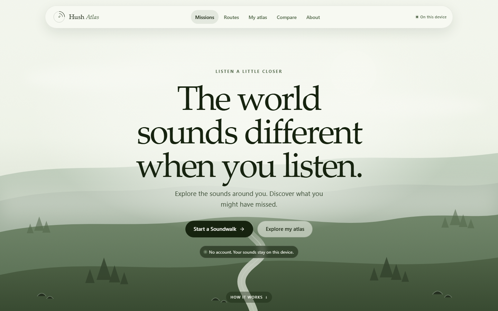

# HUSH ATLAS

**Map the world by listening.**

An open-source AI soundscape explorer. Walk a route, record what you hear, and turn the evidence into a map you can revisit.

Hush Atlas is a working local-first full-stack application, not a visual mockup. It keeps field recordings and Soundwalk sessions in SQLite, runs the real YAMNet model on the machine that holds the archive (your own machine by default), and makes the resulting evidence inspectable without pretending that a model's label is a species, a census, or a cause. **On-device AI** runs Gemma 2 2B in the browser through WebLLM and WebGPU for written reflections.



Built for **#devchallenge #hf26challenge**.

## What it does

- **Mission-first listening.** The home page offers three real activities: **Five Sounds**, **One Place, Two Moments**, and **Find the Quiet**. Each mission has a minimum, suggested, and maximum number of stops, and completion is derived from saved recordings rather than a score.
- **Persistent Soundwalks.** Create a route, name its stops, and work through them at your own pace. Pause a walk, close the browser, and resume later. Every stop, observation, recording, and analysis is stored locally.
- **Listen before recording.** A stop starts in `ready_to_listen`. The recorder is not shown until you explicitly mark that you have listened and unlocked it.
- **Observations are separate from model labels.** Your written notes are stored on the stop. YAMNet's broad AudioSet classes are stored with the recording. Neither field overwrites the other.
- **Explicit recording controls.** Record from the microphone or upload a WAV/FLAC/MP3/Ogg file. The recorder shows its state, duration, and limit; audio is written to the local archive before analysis starts.
- **Failed analyses preserve the clip.** If YAMNet fails, the original audio remains playable and downloadable, the failure is visible, and analysis can be retried.
- **Real YAMNet inference.** YAMNet (AudioSet, 521 classes) scores audio in 0.96-second windows with a 0.48-second hop. The local app runs it on your machine; a hosted instance runs it on its API server and the interface asks for consent before any upload. The full score matrix, class statistics, event spans, model version, class-map hash, threshold, and timestamps are retained.
- **Sound maps without remote tiles.** The walk map is an ordered route diagram built from saved stops. Optional coordinates are displayed as saved metadata only; no basemap, tile server, or network request is required.
- **Repeat visits and comparisons.** Save a route, walk it again, and compare the two visits stop by stop. The comparison engine calculates detection rates and percentage-point differences deterministically.
- **Evidence investigation.** Every comparison result opens back into the original recordings, event rails, stop context, window counts, warnings, and the exact method notes. Old obituary links redirect to the evidence view.
- **Fingerprints and exports.** Each recording has a soundscape fingerprint. Walk and comparison reports are generated as Markdown downloads from the local data.
- **On-device AI.** Gemma 2 2B (4-bit, about 1.4 GB) runs inside the browser with WebLLM and WebGPU. The user starts the download, sees real progress, can cancel or resume, can run a test response, and can remove the cached model. It is marked ready only after a real load and inference succeed. Browsers without WebGPU or enough storage get an honest explanation while every other feature keeps working. Written reflections remain clearly separated from YAMNet's audio labels; the model never computes a rate or comparison.
- **Deployable front end and API.** The React build works on Vercel against a FastAPI service on Render. The remote-mode interface names the API host and requires explicit consent before audio leaves the browser. Configuration and limitations are in [docs/DEPLOYMENT.md](docs/DEPLOYMENT.md).
- **Clearly labelled sample archive.** Four synthesized recordings are analyzed by the same real YAMNet pipeline, linked to a completed sample Soundwalk, and stored in a flagged demo place. The sample is excluded from your archive counts and can be removed without touching your data.
- **A quieter visual language.** The interface uses a light sage travel-landing palette, a local landscape illustration, floating rounded navigation, and restrained editorial type. The same system carries through missions, walks, recording, results, maps, comparisons, and settings. All illustrations and fonts are local; no remote images or font services are used.

## Design

The home page is a full-width landscape with a floating pill navigation and centered hero copy. The headline is **“The world sounds different when you listen.”** and the two primary actions are **Start a Soundwalk** and **Explore my atlas**. The page then explains the loop in three steps: **Listen**, **Discover**, and **Return**.

The palette is light sage and forest green (`#B5C3B4`, `#EFF3E9`, `#16230F`, `#526749`, `#C1D0BE`, `#738A6C`), adjusted only where contrast needed it. The landscape is a local SVG; there are no remote images, fonts, or map tiles. The same tokens and components carry the language into walks, recording, results, maps, comparisons, and settings.

## Quick start on Windows

### Requirements

| Component | Requirement |
| --- | --- |
| Operating system | Windows 10 or 11 |
| PowerShell | 5.1 or newer |
| Python | **3.12.x** (TensorFlow 2.16.1 does not support 3.13/3.14) |
| Node.js | 20 or newer, with npm |
| Disk space | Roughly 1.5 GB for the virtual environment, TensorFlow, model weights, and dependencies |
| On-device AI | A WebGPU browser with roughly 1.7 GB of free cache space and `shader-f16`; the app explains when the device does not qualify |
| Deployment | A Vercel account and a Render account, only if you want to publish the hosted setup |

### Install

```powershell
Set-Location E:\aftertone
powershell -ExecutionPolicy Bypass -File .\scripts\setup.ps1
```

`setup.ps1` creates `.venv`, installs the pinned Python and frontend dependencies, downloads the official YAMNet weights, verifies their SHA-256, and builds `frontend/dist`.

If Python 3.12 is not registered with the Windows launcher, install it from [python.org](https://www.python.org/downloads/) and enable the launcher. The script also checks `python3.12`, `python`, and, when available, `uv python find 3.12`.

### Start

```powershell
powershell -ExecutionPolicy Bypass -File .\scripts\start.ps1 -Open
```

Open **https://localhost:8765** if the browser does not open. The address bar shows a normal trusted HTTPS lock because `setup-https.ps1` creates a local certificate with mkcert and installs its authority for the current Windows user. The first run may ask you to approve that authority once. The API documentation is at `/docs`. Press `Ctrl+C` to stop.

The first analysis loads YAMNet into memory, which may take a few seconds. Later analyses reuse the loaded model. Everything binds to `127.0.0.1`; the app has no authentication and must not be exposed to a network.

### Local HTTPS

The launcher calls `scripts\setup-https.ps1` automatically. To run the steps yourself:

```powershell
# Install mkcert once (Windows Package Manager)
winget install FiloSottile.mkcert

# Create or refresh the local authority and leaf certificate
powershell -ExecutionPolicy Bypass -File .\scripts\setup-https.ps1

# Start the production build over HTTPS
powershell -ExecutionPolicy Bypass -File .\scripts\start.ps1

# Start Vite with the /api proxy over HTTPS
powershell -ExecutionPolicy Bypass -File .\scripts\start-dev.ps1

# Stop servers started from this repository
powershell -ExecutionPolicy Bypass -File .\scripts\stop.ps1
```

`setup-https.ps1` issues `certs\server.crt` for `localhost`, `127.0.0.1`, `::1`, the computer name, and current LAN addresses, and copies the public authority to `certs\mkcert-rootCA.crt` for phones. The private key stays in `certs\` and in `%LOCALAPPDATA%\mkcert`; both are gitignored. If HTTPS does not appear trusted:

```powershell
mkcert -CAROOT
Get-ChildItem Cert:\CurrentUser\Root | Where-Object { $_.Subject -like '*mkcert*' }
Invoke-WebRequest https://localhost:8765/api/health -UseBasicParsing
```

A certificate error means the authority is not trusted for the current user. Run `mkcert -install` in an interactive PowerShell window and approve the Windows prompt. If Vite reports that the certificate is missing, rerun `setup-https.ps1`. Do not disable certificate verification or browser security to work around it.

### Open it on a phone

Both devices need to be on the same network. Start the phone version instead:

```powershell
powershell -ExecutionPolicy Bypass -File .\scripts\start-lan.ps1
```

It serves HTTPS and prints an address such as `https://10.131.3.208:8765`. Type that into the phone. If the page does not load, run the firewall command the script prints.

The phone does not yet know the local authority, so the first visit shows a certificate warning. Install the authority once; do not use a browser flag that ignores certificate errors:

1. Open **`/local-ca.crt`** on the phone and install it as a CA certificate.
2. Reopen the HTTPS address. The warning is gone and the microphone works.

The endpoint serves `certs\mkcert-rootCA.crt`, the public half of the same mkcert authority that signs the server certificate.

- **Android:** Settings → Security → Encryption & credentials → Install a certificate → CA certificate. The exact path varies by manufacturer.
- **iPhone:** Install the downloaded profile, then Settings → General → About → Certificate Trust Settings → enable full trust.

The server certificate is regenerated on each start and includes every current local address, so a changed Wi-Fi address keeps working. The authority is kept, so the phone only trusts it once. The files live in `certs/`; `rootCA.key` is private and must not be copied anywhere.

The app has no login. Use this only on a network you trust, and stop the server when you are finished.

To browse and upload files without HTTPS, add `-Http`. The phone's browser will not allow microphone recording on that address, and the recorder explains this in the page.

An Android phone connected by USB can also use `adb reverse tcp:8765 tcp:8765` and open `http://localhost:8765`; `localhost` counts as a secure page.

### Run the checks

```powershell
powershell -ExecutionPolicy Bypass -File .\scripts\test.ps1
```

This runs pytest, Vitest, and the production TypeScript/Vite build. The real-model smoke tests are included when `models\yamnet\yamnet.h5` is present; they skip with a clear reason when it is absent.

### Other setup options

```powershell
# Backend only, no frontend install/build
.\scripts\setup.ps1 -SkipFrontend

# Leave the model download for later
.\scripts\setup.ps1 -SkipModels
.\scripts\download-models.ps1

# Re-download and verify the weights
.\scripts\download-models.ps1 -Force

# Backend tests only, or frontend tests without a build
.\scripts\test.ps1 -SkipFrontend
.\scripts\test.ps1 -SkipBuild
```

## Development mode

The supported path is one command that prepares the certificate and starts both servers:

```powershell
powershell -ExecutionPolicy Bypass -File .\scripts\start-dev.ps1 -Open
```

Open **https://localhost:5173**. Vite terminates HTTPS with the mkcert certificate and proxies `/api` to `127.0.0.1:8765`, so the page and API share one secure origin and there is no mixed content. Vite refuses to start when `VITE_HTTPS_REQUIRED=1` and the certificate is missing.

To run the two processes yourself, keep the backend on the proxied port and let Vite use the existing certificate:

```powershell
# Terminal 1, from the repository root
Set-Location backend
..\.venv\Scripts\python.exe -m uvicorn app.main:app --host 127.0.0.1 --port 8765 --reload
```

```powershell
# Terminal 2
Set-Location frontend
$env:VITE_HTTPS_REQUIRED = "1"
npm run dev
```

If the certs are absent, `npm run dev` falls back to HTTP unless `VITE_HTTPS_REQUIRED=1`; run `setup-https.ps1` rather than lowering browser security. `VITE_DEV_HOST` changes the bind host and `VITE_DEV_API_TARGET` changes the proxy target. For a single-process production build, FastAPI serves `frontend/dist` itself, so Node is not needed at runtime.

## The Soundwalk flow

1. **Choose a mission.** A mission sets the invitation, not the result. The suggested stop count is guidance; you can add or remove stops within the mission's limits.
2. **Choose or create a place.** Manual places and stops always work. GPS is requested only after you press a location button, and coordinates are optional.
3. **Build or reuse a route.** A saved route keeps stop pairing stable for later visits. A new route is saved with the walk.
4. **Listen at each stop.** Mark that you have listened, then unlock the recorder. You can write an observation before or after recording.
5. **Record and analyze.** The clip is saved locally, then YAMNet analysis is queued. The stop moves through recorded, analysis pending, analyzed, and reviewed states.
6. **Finish and revisit.** Complete the walk to close the session. Reopen it, repeat the route, or compare it with an earlier visit.
7. **Investigate the evidence.** Open the map, a recording fingerprint, or a comparison result. The original audio, windows, thresholds, and warnings stay attached.

## How the analysis works

1. **Validate and decode.** `soundfile` reads the header and a streaming amplitude envelope. Files are limited to 80 MB, 180 seconds, 8 channels, and 96 kHz by default. Unsupported, damaged, silent, too-short, and over-limit files are rejected with actionable messages. Audio is processed without loudness normalization.
2. **Convert to YAMNet input.** Channels are averaged and the signal is resampled with a polyphase filter to 16 kHz mono float32.
3. **Run YAMNet.** The vendored TensorFlow model code and official 521-class map are used unmodified. Scores are computed per window by the model itself.
4. **Persist evidence.** Windows at or above the detection threshold are counted per class. Contiguous detected windows become event spans. The score matrix is saved as a compressed `.npz` file under `data/analysis/`; statistics and event records go into SQLite.
5. **Compare.** For each recording, a class detection rate is the share of its valid windows at or above the comparison threshold. A group rate is the unweighted mean of its recordings' rates, so a long recording does not dominate. Differences are percentage points. The language model, when present, never computes these numbers.
6. **Read.** The comparison page exposes counts, warnings, group members, per-recording evidence, and fading traces. Each result links to the underlying recordings and stop context.

Default thresholds are a **0.20 detection score** and a **10 percentage-point fading threshold**. Both are visible in the interface and stored with the comparison snapshot. A class can only be a fading trace when its earlier rate is at least 5% and its rate actually falls.

## The sample archive

The sample is generated locally from deterministic synthesis code: filtered noise, chirps, rain-like transients, and low-frequency traffic rumble. The WAV files are then uploaded, analyzed, compared, and linked to a completed sample Soundwalk through the same production pipeline as user recordings.

The sample is intentionally separated:

- Its place has `is_demo = true`.
- It is excluded from home and place counts.
- Its notes say that the audio is synthetic and the dates are invented.
- Its completed walk, route, map, recordings, and comparison are clearly labelled as illustrative.
- Deleting the sample deletes its audio, analysis evidence, route, and walk without touching your archive.

## On-device AI

The writing feature is called **On-device AI**. It is a real language model, not a hosted API and not a mock:

| Item | Value |
| --- | --- |
| Model | Gemma 2 2B instruction-tuned |
| Quantization | 4-bit (`q4f16`) |
| Download | about 1.4 GB (1,492,990,789 bytes) |
| Memory | about 1.9 GB VRAM |
| Runtime | WebLLM 0.2.86 on WebGPU |
| Context | 4,096 tokens |
| Required GPU feature | `shader-f16` |
| Where it runs | A Web Worker in the browser; inference stays on the visitor's GPU |

Open **About → On-device AI** and choose **Download model**. The browser receives the model from the WebLLM/MLC distribution only after that action; Hush Atlas never downloads it automatically. The panel shows the real model name and size, the detected GPU adapter, and the runtime's own progress. A download can be cancelled, and a later visit offers **Resume download** when the browser has a partial or complete cache. After the download, **Start AI** loads the weights and runs a real test inference. **AI ready** appears only after that response succeeds; the panel never claims readiness from a cached file alone. **Remove downloaded model** deletes the cached weights after a confirmation step.

The model is kept in the browser's Cache Storage through WebLLM, never in `localStorage`. Browsers may evict cached data under storage pressure. If that happens the panel reports the model is no longer installed and offers the download again. A device without WebGPU, without `shader-f16`, with an unusable adapter, or with too little free storage gets a plain unsupported message; recording, upload, YAMNet analysis, maps, and comparisons remain available.

Browser support is detected at runtime rather than inferred from a user-agent string. Current desktop Chrome and Edge builds generally qualify. Mobile support depends on the browser and GPU, so no claim is made that every phone can run it. The About panel reports the actual answer for the device in front of you.

Reflections use a compact evidence sheet: place, sound type, earlier and recent detection rates, the direction and size of the difference, the atlas classification, and an explicit statement that the cause is unknown. The text is checked for unsupported causes, environmental speculation, permanence claims, proof claims, URLs, percentages, and years, and is labelled as a written reflection rather than a measurement. A deterministic **plain reading** remains available with no model at all.

### Development fallback: server-side Ollama

The repository retains the earlier server-side reflection endpoints for compatibility with existing installations. They contact only a **loopback** Ollama endpoint (`127.0.0.1`, `localhost`, or `::1`) and never accept a cloud endpoint or API key. The About page no longer presents Ollama as a writing option; the browser model is the supported user-facing path.

```powershell
ollama pull gemma3:4b
```

The endpoints still detect compatible installed models and validate their output. If Ollama is missing, reachable but empty, or returns text that fails validation, the API returns a clearly labelled deterministic fallback. A deployed Render instance has no loopback Ollama, so this path stays unavailable there.

## Data and privacy

| Path | Contents |
| --- | --- |
| `data/silence_archive.sqlite3` | Places, recordings, routes, walk sessions, stops, analysis metadata, class statistics, events, comparisons, narration cache, settings |
| `data/audio/` | Original uploaded audio files, named with opaque IDs |
| `data/analysis/` | Compressed score matrices and evidence artifacts |
| `data/logs/` | Local application logs and temporary synthesis files |
| `models/yamnet/yamnet.h5` | Downloaded official weights; ignored by git |

The database filename keeps its original name so an existing Silence Archive database is upgraded in place. The visible application is Hush Atlas.

Audio is never stored as a SQLite blob. The SQLite database, audio, and analysis files are **not encrypted at rest**. Protect the folder with your operating-system account permissions and backups. A recording can contain speech or other sensitive sound; the local app keeps it on your machine but cannot make it private after you copy or share the folder. A hosted deployment stores it on the server instead, as described above.

The local app makes no telemetry, analytics, font, image, or map-tile requests, and it has no remote visual assets. Network operations are limited to dependency/model installation, a loopback Ollama request when that development fallback is enabled, a browser model download after the user chooses **Download model**, and, in hosted mode, HTTPS requests to the configured API.

In hosted mode the API receives the audio the visitor explicitly submits, analyzes it with YAMNet on the server, and stores it on the server's persistent disk. The recording interface names the API host, explains that the server will process and keep the clip, and requires a consent checkbox before upload. Raw audio is not retained in browser storage; the browser keeps only the On-device AI model weights and small reflection text. Hosted mode therefore does **not** keep recordings on the visitor's device, and the deployment is not private by default: see [docs/DEPLOYMENT.md](docs/DEPLOYMENT.md).

## Database migration

Schema version 2 adds routes, route stops, walk sessions, and walk stops, plus links from recordings and comparisons to walk context. The migration is additive and runs automatically at startup:

- Existing places, recordings, analysis runs, and comparisons are preserved.
- New columns are added with safe defaults.
- New tables are created if absent.
- Running the migration twice is idempotent.
- A database from a newer schema version is refused rather than modified.

Back up `data/silence_archive.sqlite3` before opening a valuable archive with a new build.

## Configuration

Copy `.env.example` to `.env` only when you need overrides. Every setting is optional; defaults live in `backend/app/config.py`. The `SILENCE_*` environment prefix is retained for compatibility with existing installations.

| Setting | Default | Purpose |
| --- | --- | --- |
| `SILENCE_DATA_DIR` | `<repo>/data` | SQLite, audio, analysis, logs |
| `SILENCE_MODEL_DIR` | `<repo>/models` | Downloaded model weights |
| `SILENCE_HOSTED` | `false` | Set `true` on a hosted deployment so health reports `local_only: false` |
| `SILENCE_MAX_UPLOAD_MB` | `80` | Upload size cap |
| `SILENCE_MAX_DURATION_SECONDS` | `180` | Recording length cap |
| `SILENCE_MAX_SAMPLE_RATE` | `96000` | Accepted source sample rate |
| `SILENCE_DEFAULT_SCORE_THRESHOLD` | `0.20` | Default YAMNet class threshold |
| `SILENCE_DEFAULT_FADING_THRESHOLD_PP` | `10` | Default fading threshold |
| `SILENCE_OLLAMA_URL` | `http://127.0.0.1:11434` | Loopback endpoint for the development fallback |
| `SILENCE_OLLAMA_MODEL` | empty | Pinned development fallback model |
| `SILENCE_OLLAMA_TIMEOUT_SECONDS` | `120` | Development fallback timeout |
| `SILENCE_ANALYSIS_WORKERS` | `1` | Background analysis workers (1-4) |
| `SILENCE_CORS_ORIGINS` | Vite dev origins | Exact browser origins allowed to call the API |

When overriding a path, prefer an absolute path. The app expands environment variables and `~`, but relative paths resolve from the process working directory. On a hosted service, point `SILENCE_DATA_DIR` and `SILENCE_MODEL_DIR` at the persistent disk; otherwise the database and recordings disappear on the next deploy.

### Frontend build settings

| Setting | Default | Purpose |
| --- | --- | --- |
| `VITE_API_BASE_URL` | unset | Same-origin `/api` proxy. Hosted builds set the full API root, including `/api` |
| `VITE_DEV_HOST` | `localhost` | Vite bind host |
| `VITE_DEV_API_TARGET` | `http://127.0.0.1:8765` | Vite proxy target |
| `VITE_HTTPS_REQUIRED` | unset | Set to `1` (the launchers do) to fail fast when no certificate exists |

Vite embeds every `VITE_*` value into the public bundle. Never put a secret or token there.

## Deployment

The repository includes `vercel.json`, `render.yaml`, and a server-side weight fetch script. [docs/DEPLOYMENT.md](docs/DEPLOYMENT.md) contains the exact Vercel and Render settings, CORS and preflight checks, persistent-storage requirements, consent behavior, and the honest limits of the hosted setup. Deployment is not claimed here until the real URLs and health checks have been verified.

## Verification

Verified on Windows 11 with Python 3.12.13, Node.js 26.7.0, PowerShell 5.1, TensorFlow 2.16.1, and the official YAMNet weights.

| Check | Result |
| --- | --- |
| Backend pytest suite | **82 passed** in 23.71 s; includes real YAMNet smoke tests |
| Frontend Vitest suite | **41 passed** across 6 files |
| TypeScript + Vite production build | Passed; 528.55 kB JS (147.56 kB gzip), 207.00 kB CSS (34.60 kB gzip), plus lazy WebLLM runtime chunks (about 6.1 MB each; 2.19 MB gzip for the library chunk) |
| Responsive sweep | 17 routes at **390 px and 834 px** (34 checks): no document-level horizontal overflow, no failed requests, no console errors or exceptions |
| Touch targets | Primary controls, map dots, inline actions, audio controls, and menu links are at least 40 px in the tested layouts |
| Phone recording | Served over HTTPS with the local authority: Chrome reported a secure context and opened a live microphone track. The same page over HTTP had no `navigator.mediaDevices`, and the recorder explained how to switch. The certificate chain verified for both `localhost` and the LAN address |
| Keyboard and motion | Skip link, visible focus, named controls, Escape-to-close menu, and reduced-motion behavior verified in Chrome |
| Offline recovery | API requests blocked in Chrome; My atlas showed a clear error, and one **Try again** refreshed all three archive resources after the network returned |
| Persistence across restart | The disposable archive was stopped and restarted with the same data directory. Places, walks, recordings, analyses, comparison, evidence, and WAV playback all survived byte-for-byte or returned the same stored records |
| Schema migration | v1 → v2 preserves existing place, recording, analysis, and comparison rows; idempotent; newer schemas refused |
| Real YAMNet smoke | 3-second 440 Hz signal; top-10 includes `Sine wave`; 521 output classes |
| Soundwalk API smoke | Create place → walk → observation → pause/resume → upload → real analysis → analyzed stop → fingerprint and map endpoints returned 200 |
| Repeat visit | Repeat creates a new active session on the same route; comparison preview pairs stops; evidence and Markdown reports return 200 |
| Sample archive | Four real analyses; completed four-stop sample Soundwalk; route map verified; comparison ready; removal returns to absent |
| On-device AI | Verified in headed Chrome 156 on Windows with an AMD RDNA-3 WebGPU adapter and `shader-f16`: the 1.4 GB Gemma 2 2B download, cache detection, load, real test inference, and a real comparison reflection all succeeded. Unsupported-device and fallback states are covered by tests |
| Hosted production-like check | Built with `VITE_API_BASE_URL` pointing at a separate HTTPS origin and served the production bundle. Verified hosted health (`local_only: false`), CORS preflight, consent-gated upload, real YAMNet analysis, rewritten audio and report URLs, hosted copy, and the download cancel/resume states. This used disposable data, not the real archive, and is not a Vercel/Render deployment |
| Browser microphone | Not exercised on physical hardware in this environment |
| Browsers | Chrome 156 headed with WebGPU for On-device AI; Chrome/Chromium headless checks for the rest of the app; Safari and Firefox were not tested |

Actual microphone capture in a physical browser was not exercised in this environment. Very long recordings near the 180-second limit were not benchmarked. The map is schematic when coordinates are absent and never uses remote tiles.

### What the model does not prove

YAMNet returns broad AudioSet classes, not verified species, sources, or causes. A detection rate is a property of the selected recordings and the model threshold. Microphone placement, gain, weather, time of day, and recording length can all change what is detected. A fading trace is a descriptive comparison, not evidence that a sound has disappeared from a place. The interface repeats these limits wherever a result could be overread.

## Project structure

```text
aftertone/
├─ backend/
│  ├─ app/                 FastAPI application, missions, walks, analysis, comparison, evidence
│  ├─ scripts/             ensure_yamnet.py for hosted weight setup
│  ├─ tests/               pytest suite, including real-model smoke tests
│  ├─ vendor/yamnet/       Unmodified upstream model code, class map, license
│  ├─ requirements.txt
│  └─ pytest.ini
├─ frontend/
│  ├─ src/                 React application, typed API client, utilities
│  ├─ src/components/      Shared components, recorder, consent notice, On-device AI panel
│  ├─ src/ondevice/        WebLLM engine, worker, capability detection, cache helpers
│  ├─ src/pages/           Missions, Soundwalk, map, routes, fingerprints, evidence, archive
│  ├─ src/styles/          Light sage travel-landing design system
│  ├─ .env.example         VITE_API_BASE_URL for hosted builds
│  └─ dist/                Production build served by FastAPI
├─ scripts/
│  ├─ setup.ps1
│  ├─ setup-https.ps1      mkcert authority and leaf certificate
│  ├─ download-models.ps1
│  ├─ download-yamnet.py   Verified hosted weight download
│  ├─ start.ps1
│  ├─ start-dev.ps1        Vite + API over trusted HTTPS
│  ├─ start-lan.ps1
│  ├─ stop.ps1
│  ├─ make-cert.ps1
│  └─ test.ps1
├─ certs/                  Local HTTPS authority and certificate, gitignored
├─ docs/
│  ├─ DEPLOYMENT.md        Vercel + Render steps and limits
│  └─ screenshots/
├─ data/                   Created at runtime, gitignored
├─ models/                 Downloaded weights, gitignored
├─ render.yaml             Render API blueprint
├─ vercel.json             Vercel build, SPA rewrite, security headers
├─ .env.example
├─ README.md
├─ DEV_POST_DRAFT.md
├─ THIRD_PARTY_NOTICES.md
└─ LICENSE
```

## API overview

The FastAPI schema is the source of truth and is browsable at `/docs`. Key routes:

- `GET /api/overview`, `GET /api/places`, `POST /api/places`
- `GET /api/missions`, `GET /api/routes`, `GET /api/routes/{id}`
- `POST /api/walks`, `GET /api/walks`, `GET /api/walks/{id}`
- `PATCH /api/walks/{id}` for pause, resume, reopen, or completion
- `PATCH /api/walks/{id}/stops/{stop_id}` for stop state and observations
- `POST /api/walks/{id}/stops/{stop_id}/recording` for stop audio
- `POST /api/walks/{id}/repeat`, `GET /api/walks/{id}/map`
- `GET /api/walks/{id}/comparison-preview`, `POST /api/walks/{id}/compare`
- `GET /api/walks/{id}/report`
- `GET /api/recordings/{id}/fingerprint`
- `GET /api/comparisons/{id}/evidence/{class_index}`
- `GET /api/comparisons/{id}/report`
- `POST /api/places/{id}/recordings`, `POST /api/recordings/{id}/analyze`
- `GET /api/recordings/{id}/audio` (with byte-range support), `GET /api/recordings/{id}/waveform`
- `POST /api/comparisons`, `GET /api/comparisons/{id}`
- `GET|POST /api/comparisons/{id}/reflection`
- `GET /api/places/{id}/map`
- `POST /api/demo/prepare`, `DELETE /api/demo`
- `GET /api/models/status`, `GET|PUT /api/models/gemma`

All application routes are under `/api`; unknown API paths return JSON 404 rather than the frontend shell.

## Troubleshooting

- **`No module named tensorflow` or a Keras error:** use the project virtual environment and confirm `TF_USE_LEGACY_KERAS=1`. `start.ps1` sets it; `setup.ps1` pins `tf-keras==2.16.0`.
- **Python 3.13/3.14 error:** remove `.venv`, install Python 3.12, and rerun setup. TensorFlow 2.16.1 is not compatible with newer Python versions.
- **Model not installed:** run `.\scripts\download-models.ps1`. The About page and `/api/models/status` report the exact missing asset.
- **Port already in use:** choose another loopback port with `.\scripts\start.ps1 -Port 8900`. If you use the Vite dev server, update its proxy target or run the API on 8765.
- **On-device AI says unsupported:** the browser has no usable WebGPU adapter or not enough storage. The rest of the app works. Try a current desktop Chrome or Edge build; the panel's **Check again** re-runs detection. Mobile support varies by browser and GPU.
- **On-device AI download stops:** cached data may have been evicted or the network may have dropped. Choose **Resume download** or set up again; the model is never marked ready without a real test inference.
- **Ollama unavailable:** only the development fallback is affected. The archive and On-device AI remain usable, and reflections show the plain deterministic reading. Start Ollama and install a Gemma model only if you want the server-side fallback.
- **Certificate warning on localhost:** the mkcert authority is not trusted. Run `mkcert -install` in an interactive window and approve the prompt, then restart the server. Do not disable certificate checks.
- **CORS error on a deployed site:** add the exact frontend origin to `SILENCE_CORS_ORIGINS` on Render, including the scheme and with no trailing slash, then restart the service. Wildcards are not used.
- **No microphone:** browser recording requires a secure context. The supplied launchers use trusted HTTPS; `127.0.0.1` is also treated as secure by current browsers, but a plain LAN address is not.
- **Location permission denied:** manual place and stop creation always works. Type coordinates only if you want them saved.

## Licensing and attribution

The application source is released under the [MIT License](LICENSE). The vendored YAMNet implementation and class map come from TensorFlow Models and remain under the Apache License 2.0; the full upstream license is retained at `backend/vendor/yamnet/LICENSE`. YAMNet weights are downloaded from Google's official AudioSet storage and are not redistributed here.

See [THIRD_PARTY_NOTICES.md](THIRD_PARTY_NOTICES.md) for sources and the main dependency licenses. The sample audio is synthesized by this project; no third-party recordings or visual assets are included.
